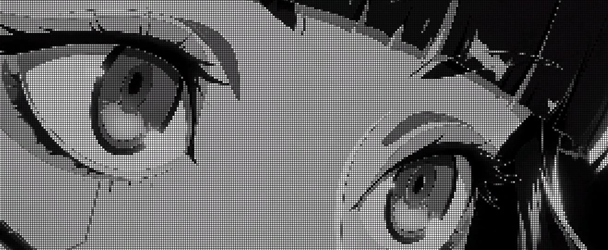
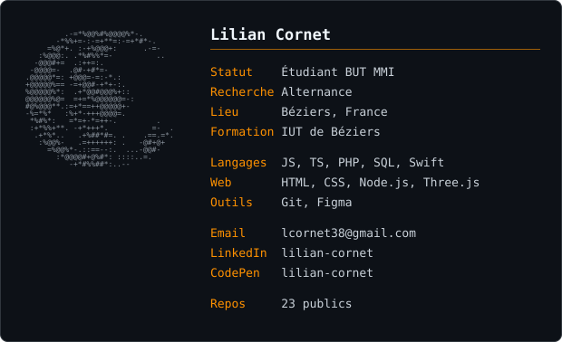
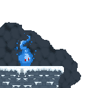

  

  

<b>Contact</b>

<b>Activité</b>

  

<b>Compétences</b>

<b>Projets</b>

Tous mes dépôts publics, triés par dernière modification. Se met à jour tout seul (toutes les 6h) — voir [`projects.config.json`](projects.config.json).

 

<!-- PROJECTS:START -->
<!-- Généré automatiquement — voir projects.config.json -->

| Projet | Description | Stack |
|---|---|---|
| **[repolink](https://github.com/zaderlyl/repolink)** | Site pour trouver des repos GitHub à sa portée et rencontrer des créateurs : recherche simplifiée, good first issues, mise en relation débutants/experts. |  |
| **[portfolio](https://github.com/zaderlyl/portfolio)** | Portfolio de Lilian Cornet — étudiant BUT MMI, développeur web et designer d'interfaces |  |
| **[survivor](https://github.com/zaderlyl/survivor)** | Survivor-like en navigateur : tenir face à des vagues d'ennemis, gagner de l'XP et choisir ses pouvoirs. Basé sur 07-Swarm de Lino Volle. |  |
| **[glass_garden](https://github.com/zaderlyl/glass_garden)** | Jeu d'aventure/exploration : traverse les miroirs d'un jardin, survis à cinq versions de la réalité, rapporte cinq étoiles et bats le chronomètre. |  |
| **[nettoyeur-pc](https://github.com/zaderlyl/nettoyeur-pc)** | Outil pour trier, noter et nettoyer les fichiers et projets de son Mac. |  |

<b>Voir les 12 autres projets</b>

| Projet | Description | Stack |
|---|---|---|
| **[claude-config](https://github.com/zaderlyl/claude-config)** | Ma configuration Claude Code versionnée : règles globales, commandes /commit /push /merge, hooks git et modèle de projet. |  |
| **[DevTober](https://github.com/zaderlyl/DevTober)** | DevTober 2026 (variante de l'Inktober pour les développeurs) |   |
| **[sans-couleurs](https://github.com/zaderlyl/sans-couleurs)** | Jeu de plateforme 2D pixel art (Phaser 3). Cartes, PNJ et dialogues définis dans Tiled plutôt que codés en dur. |  |
| **[contribution-board](https://github.com/zaderlyl/contribution-board)** | Animations SVG originales pour ta grille de contributions GitHub (canon, et d'autres à venir) — s'utilise comme une GitHub Action |  |
| **[phaser-ui-editor](https://github.com/zaderlyl/phaser-ui-editor)** | Éditeur web façon Figma pour Phaser : construire des écrans d'UI à la souris et générer le code Phaser correspondant. |  |
| **[loup-garou-mj](https://github.com/zaderlyl/loup-garou-mj)** | Panel web pour le Maître du Jeu d'une partie de Loup-Garou de Thiercelieux, utilisable depuis son téléphone et sans backend. |  |
| **[backtrace](https://github.com/zaderlyl/backtrace)** | Thriller pour développeurs jouable dans le navigateur : une enquête faite d'énigmes techniques (HTML, Base64, JavaScript, terminal). |  |
| **[pc-pet](https://github.com/zaderlyl/pc-pet)** | Compagnon flottant desktop (Asti / PC Pet) — moteur du compagnon de Nothing OS |  |
| **[Nothing-OS](https://github.com/zaderlyl/Nothing-OS)** | Noyau x86_64 bare-metal écrit en Rust, bootable dans QEMU : système de fichiers persistant, pilotes ATA/PCI, partage de dossier hôte via virtio-9p, interface entièrement au clavier. |  |
| **[Musee--FABI](https://github.com/Bebbou/Musee--FABI)** | Projet de groupe (SAÉ) : site d'un musée avec back PHP/MySQL et visite en 3D dans le navigateur (Three.js, modèles glTF). |     |
| **[Spoti-Stat](https://github.com/zaderlyl/Spoti-Stat)** | Tableau de bord de statistiques d'écoute Spotify (API Spotify). |  |
| **[SAE105](https://github.com/zaderlyl/SAE105)** | Site de visite virtuelle des Halles de Béziers : parcours 360° du marché couvert en A-Frame (WebVR), présentation des commerçants, pages À propos et contact. Projet SAÉ 105 — BUT MMI. HTML / CSS / JS. |  |

<!-- PROJECTS:END -->

<b>Badges</b>

 
<!-- my-badges start -->

<!-- my-badges end -->

